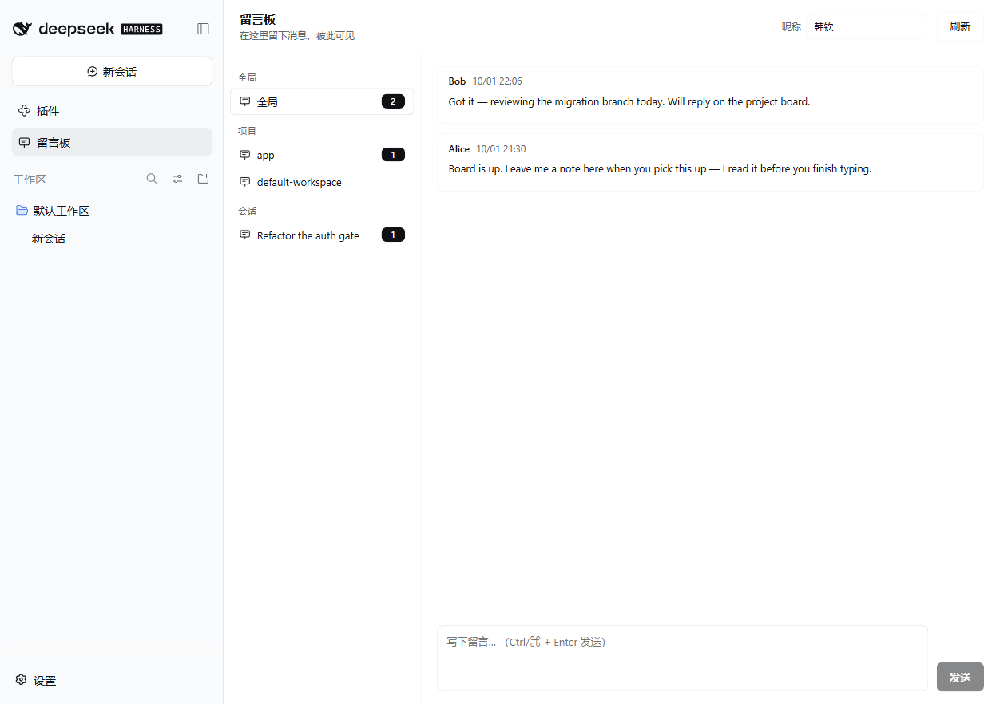
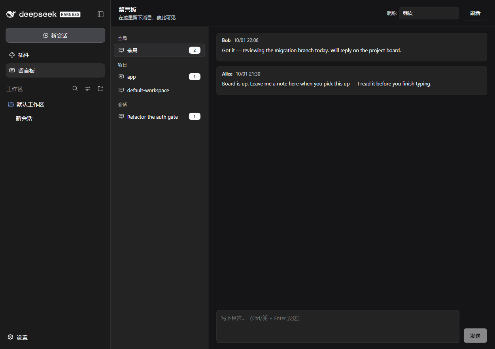

# dsh-plugin-message-board

A shared message board for [DeepSeek Harness](https://github.com/deepseek-ai/deepseek-harness).

When more than one person uses the same DSH instance — a laptop your teammate
connects to, a shared box behind a tunnel — the conversation history is the only
place to leave something behind, and it is a bad place for it: it is per-session,
it is linear, and writing in it makes the agent act. This plugin adds a quiet
side channel instead. Leave a note, and the other person sees it the next time
they open the board.

Notes are scoped three ways:

| Scope | Board | Use it for |
|---|---|---|
| **Global** | one per instance | "deploy is frozen until Thursday", "the VM is rebooting" |
| **Project** | one per workspace directory | "the build is green again", "don't touch the lockfile" |
| **Session** | one per session | "here are the open questions in this session" |

Every note is attributed and carries a per-reader watermark, so you can tell
whether the other person has actually seen it.



<sub>English | [中文](README.zh.md)</sub>

## Features

- **Three scopes** — global, per project, per session, with a single rail that
  shows every board that holds notes.
- **Mutual visibility with read receipts** — each reader has their own
  watermark; your own notes show `✓ read by …` once the other person opens the
  board, and theirs are highlighted until you do.
- **One click from a session** — a board button in the session header opens that
  session's board directly.
- **The agent can read and write the board too** — two tools, so a note left for
  the agent is something it can actually act on.
- **Zero dependencies, no build step** — plain JavaScript, `node:` builtins only,
  React from the browser module table. Copy the directory and it runs.
- **Reuses DSH's own browser session** — the HTTP API is admitted by the same
  trust and cookie policy that guards `/api`, so there is no second credential
  to manage.
- **Theme-aware and localized** — theme tokens only, so light and dark both read
  correctly; UI text is registered through the Client locale service (中文 / English).



## Install

A bundle install has two effects: the package becomes resolvable from the
profile, and its patch layer is applied.

### Into the profile you are running

Ask the agent in that session to install it, pointing at the checkout:

```
plugin_manager install_bundle → /absolute/path/to/dsh-plugin-message-board
```

### Into any profile, from a shell

```bash
git clone https://github.com/<you>/dsh-plugin-message-board.git
dsh plugin --profile <profile> add /absolute/path/to/dsh-plugin-message-board
```

`dsh plugin add` installs the package and, because the manifest declares
`dsh.bundle.patch`, records the bundle in the profile's
`dsh.profile.bundles` in one step.

### Then restart the host

The Host half is a Node module. **A change to `index.js` only takes effect after
the DSH host process restarts** — neither a page refresh nor a
`remove_bundle`/`install_bundle` cycle re-imports an already-loaded module
generation. The Client half (`client.js`) is fetched as a browser artifact, so it
*does* refresh with the page.

## Configuration

Override the row's `config` from your own patch layer. A matching `id` replaces
the **whole** config, so restate every field you still want.

```yaml
- id: message-board
  name: 'dsh-plugin-message-board'
  config:
    identityHeader: x-gateway-user
    allowDelete: true
```

| Key | Default | Meaning |
|---|---|---|
| `routePath` | `/dsh-message-board` | Prefix route on `ctx.webServer`. Stored without a trailing slash — a prefix route matches `p` and `p/<anything>`, so a trailing slash would match nothing. `/` is refused. |
| `dataFile` | `$DSH_HOME/message-board/board.json` | Board database. Created on first write, written atomically. |
| `identityHeader` | `""` | Optional request header carrying the authenticated user name. See below. |
| `allowDelete` | `true` | Authors may delete their own notes. |
| `agentTools` | `true` | Register `message_board_read` / `message_board_post`. |
| `agentAuthor` | `DSH Agent` | Author name the tools write under. |
| `maxMessagesPerBoard` | `2000` | Oldest notes are dropped past this count. |

### Identity on a shared instance

DSH itself has one operator, so the plugin cannot know *which* human is typing.
It takes the name from a small field in the panel header, remembered per browser
in `localStorage`.

If you put your own authenticating proxy in front of DSH — an HTTP basic-auth
gateway, Cloudflare Access with a header, an SSO sidecar — point
`identityHeader` at the header it sets and the name becomes authoritative:

```yaml
- id: message-board
  name: 'dsh-plugin-message-board'
  config:
    identityHeader: x-gateway-user
```

The header wins over anything the browser claims, so the panel shows who the
proxy authenticated rather than who the browser claims to be.

## Agent tools

Both are registered on every session.

| Tool | What it does |
|---|---|
| `message_board_read` | Read a board's notes. `scope` is `global`, `project`, or `session`; `session` defaults to the calling session. |
| `message_board_post` | Leave a note. Same scopes; `label` records a human-facing board title. |

A note left on a session board is something the agent working in that session can
pick up:

```
> post a note on this session's board saying the flaky test is the rerun loop

… message_board_post { scope: "session", text: "The flaky test is the rerun loop." }
```

## HTTP API

The Client half talks to the Host half over a prefix route. Every response is
JSON, and every failure uses the same envelope.

| Method | Path | Body / query |
|---|---|---|
| `GET` | `api/boards` | `?author=` → every board with counts and read watermarks |
| `GET` | `api/messages` | `?board=` → one board's notes, newest first |
| `POST` | `api/post` | `{ board, text, author?, label? }` |
| `POST` | `api/read` | `{ board, author? }` → advance that reader's watermark |
| `POST` | `api/delete` | `{ id, author? }` → author only |

Requests are admitted by `ctx.connection.requestRejection(...)`, the same
Host/Origin/trust check and signed browser-session cookie that guards DSH's own
`/api`. An untrusted `Host` gets `403`, a missing or stale session gets `401`.

## How it works

```
ctx.webServer  ──prefix route──▶  index.js   (Host half)
                                     │  board.json, atomic writes
                                     ├─ ctx.connection.requestRejection  → trust + cookie
                                     └─ ctx.tools.register               → agent tools

slots ──▶ client.js  (Client half: sidebar.panellist, main, session header)
             └─ fetch('/dsh-message-board/api/…', credentials: same-origin)
```

- The Host half owns the store and the HTTP API. It registers the mount point
  into the page through `ctx.webServer.tapIndex`, so a custom `routePath` needs
  no matching edit in `client.js`.
- The Client half renders three slot contributions and never imports a Harness
  Client package: React comes from the browser module table, and the only thing
  shared with the host is the `--dsw-alias-*` theme tokens.
- Text drawn on a `--dsw-alias-brand-primary` fill uses `--dsw-alias-bg-base` as
  its foreground. The two are inverse surfaces in both shipped themes, so the
  pairing stays legible when the theme flips.
- Writes are serialized through an in-process queue and persisted with
  write-temp-then-rename, so a crash cannot leave a half-written board.

### Data format

```json
{
  "version": 1,
  "boards": {
    "global": {
      "scope": "global", "target": "", "label": "",
      "createdAt": "2026-10-01T13:30:44.847Z",
      "readAt": { "Alice": "2026-10-01T14:09:44.847Z" }
    },
    "session:session-8f21c0": {
      "scope": "session", "target": "session-8f21c0",
      "label": "Refactor the auth gate",
      "createdAt": "2026-10-01T13:54:44.847Z",
      "readAt": {}
    }
  },
  "messages": [
    {
      "id": "mb_demo_1", "board": "global", "scope": "global", "target": "",
      "author": "Alice", "text": "…", "createdAt": "2026-10-01T13:30:44.847Z"
    }
  ]
}
```

A board key is `global`, `project:<path>`, or `session:<session id>`. "Unread"
is derived, not stored: a note is unread for a reader when its `createdAt` is
newer than that reader's watermark.

## Security

- **The board is not a secret channel.** Its API is reachable by anyone who can
  reach the DSH web UI with a valid browser session — which is everyone who can
  use the agent, and the agent can already run commands. Do not put credentials
  in a note.
- **The API is only as strong as the deployment around it.** On a loopback-only
  DSH, that is your machine. Behind a tunnel, it is whatever guards the tunnel.
  If you expose DSH directly to a network, the board is exposed with it.
- **`routePath` must stay reserved.** Do not point another plugin at the same
  prefix; the webserver throws on a duplicate route, which fails the load.

## Development

The Host half has a contract test suite that needs no DSH at all. It stands in
for the two services the plugin uses and copies their real rules from the DSH
source — route matching (`prefix` p matches `p` and `p/<anything>`) and the
Host/Origin trust fence:

```bash
node --test test/host.test.mjs
```

To exercise the Client half, install the bundle into any profile and restart the
host. `client.js` reloads with the page; `index.js` does not.

## Compatibility

Built and verified against DSH `0.2.0-rc.2`. The plugin relies on
`ctx.webServer.register` (`prefix` routes), `ctx.connection.requestRejection`,
`ctx.tools.register`, the `sidebar.panellist` / `main` /
`conversation.session.header.utilities` slots, and the `--dsw-alias-*` theme
tokens.

## License

MIT — see [LICENSE](LICENSE).
